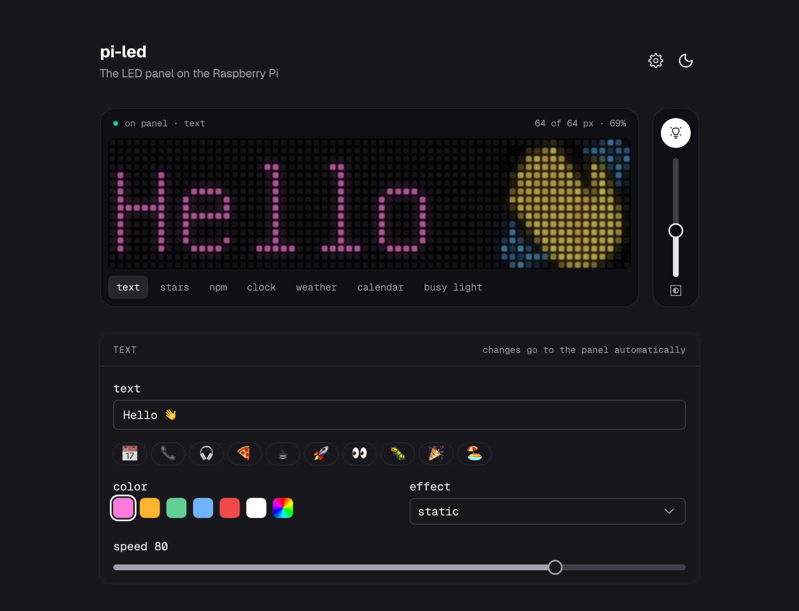

# led

A desk display from an iPixel Color Bluetooth LED panel (64×16, such as the [Briloner LED message board](https://www.action.com/nl-be/p/3226274/briloner-led-berichtenbord/) from Action, article 3226274) and a Raspberry Pi. The Pi keeps one Bluetooth connection to the panel and serves an HTTP API, a control page with a live preview, and an MCP endpoint so Claude can write to the panel.



## Screens

The control page has seven tabs:

- Text, with color, effects and one-tap emoji presets
- The GitHub star count of a repository you pick
- The downloads of an npm package you pick, over the last day, week, month or year
- A clock
- The weather for a place you search, from [Open-Meteo](https://open-meteo.com), redrawn every 10 minutes
- The next event from a private iCal link ("in 12m", "1h16m", a time later today, "tmrw" or "free"), then its title on a second page
- A busy light: the panel glows green when you're free, orange shortly before a work meeting and red during one. When you turn that on in `/settings`, it switches to this on its own and goes back to the previous screen when the meeting ends. Otherwise it only shows when you pick it, so your text stays.

The Pi draws every screen except text itself, and the preview shows the same pixels. `/settings` holds the GitHub repository, the npm packages, the weather location, the calendars (each work or personal, and work ones drive the busy light), the busy light, night mode (screen off and on at set times) and the text presets.

Settings are saved on the Pi in `~/.local/share/pi-led`, outside the clone, and handed back to the Python service whenever it or the control page restarts. Calendar links never leave the Pi, and the page only sees their names and hosts.

## Install

On a Raspberry Pi with Bluetooth (built on a Pi 4 with Raspberry Pi OS Lite):

```bash
git clone https://github.com/stijnvanhulle/led.git ~/led && ~/led/install.sh
```

The script installs Bluetooth, Python and Node 22 with pnpm, builds the control page, scans for the panel and asks for its address (it shows up as `LED_BLE_…`), then starts the services. Open `http://<pi>`, where `<pi>` is the Pi's hostname or Tailscale name.

To use Wi-Fi, run `sudo nmtui connect` on the Pi and pick your network. With a cable plugged in too, the Pi prefers Ethernet and falls back to Wi-Fi when the cable comes out.

The panel accepts one Bluetooth connection at a time and the service keeps it open, so the phone app can't connect while it runs. Stop it with `sudo systemctl stop ledserver` to use the app. When the panel loses power, it starts again on its power-on screen, and the Pi puts the last screen back within about 15 seconds.

## Deploy

The Pi checks `main` every 5 minutes. When it has moved, the Pi installs the dependencies, rebuilds the control page, updates the systemd units and restarts both services. To see the last deploy:

```bash
journalctl -u led-update -n 20
```

## Claude (MCP)

The control page's server has an MCP endpoint at `/mcp` with three tools: `show_text`, `show_stars` and `panel_status`. Add it to Claude Code:

```bash
claude mcp add --transport http led http://<pi>/mcp
```

Then ask Claude to put a message on the panel when it finishes a task.

## Power-on screen

Whatever is saved in the panel's slots (1–10) shows when it powers on, until the Pi sends something. `boot_screen.py` saves a small snake animation in slot 1, the same one the page shows while it connects:

```bash
~/led/.venv/bin/python ~/led/boot_screen.py
```

To remove a message saved from the phone app, clear the slots. This also resets settings stored on the panel, such as brightness:

```bash
curl -X POST http://<pi>:8080/command/clear
```

## API

The Python service listens on port 8080. The control page passes its `/api/*` calls on to it.

| Method | Path | Body | What it does |
|---|---|---|---|
| `POST` | `/command/<name>` | the keyword arguments of that [pypixelcolor](https://pypi.org/project/pypixelcolor/) command | runs the command on the panel |
| `POST` | `/stars` | optional `{"repo": "owner/name", "color": "ffd700"}` | shows the star count |
| `POST` | `/repo` | `{"repo": "owner/name"}` | tracks another repository without changing the screen |
| `POST` | `/clock` | `{"color": "6fb6ff", "h24": true, "blink": true}` | shows the clock |
| `POST` | `/weather`, `/calendar`, `/npm` | optional `{"color": "ffffff"}` | shows that screen |
| `POST` | `/busy` | optional `{"force": true}` | shows the busy light, and with `force` shows busy whatever the calendars say |
| `POST` | `/config` | any of `weather` (`name`, `lat`, `lon`), `calendar` (`url`), `night` (`enabled`, `off`, `on`), `busy` (`urls`, `auto`, `soon`, `force`) and `npm` (`package`, `period`) | changes those settings |
| `GET` | `/preview?text=…` | | the pixels `send_text` would draw |
| `GET` | `/preview/stars`, `/preview/weather`, `/preview/calendar`, `/preview/npm` | | the frames on the panel |
| `GET` | `/health` | | the current screen and settings |

```bash
curl -X POST http://<pi>:8080/command/send_text -H 'Content-Type: application/json' -d '{"text":"Hello","color":"ff0000"}'
```

Any display command switches the screen, while settings such as brightness keep it. An unknown command name returns the list of valid ones. `send_image` is left out because it reads a file on the Pi. Use `send_image_hex` instead.

The API, the control page and `/mcp` have no authentication, so keep the Pi on your own network or tailnet.

## Configuration

Settings for the Python service go in `~/led/.env`:

| Variable | Default | |
|---|---|---|
| `LED_ADDRESS` | required | the panel's Bluetooth address. `install.sh` sets it, and `~/led/.venv/bin/pypixelcolor --scan` lists it |
| `PORT` | `8080` | |
| `API_TOKEN` | none | when set, requests need `Authorization: Bearer <token>`. The control page doesn't send it, so only set it when you use the API on its own |
| `GITHUB_REPO` | `kubb-labs/kubb` | the repository until one is picked in the settings |
| `STARS_INTERVAL` | `600` | seconds between star checks |
| `GITHUB_TOKEN` | none | raises GitHub's limit of 60 requests an hour |

## Development

The control page is a Nuxt 4 app with Nuxt UI in `web/`. Run it against the Pi:

```bash
cd web && pnpm install && NUXT_LED_API=http://<pi>:8080 pnpm dev
```

`features.py` has a self-check for the weather, calendar, busy light and night mode logic:

```bash
~/led/.venv/bin/python ~/led/features.py
```
